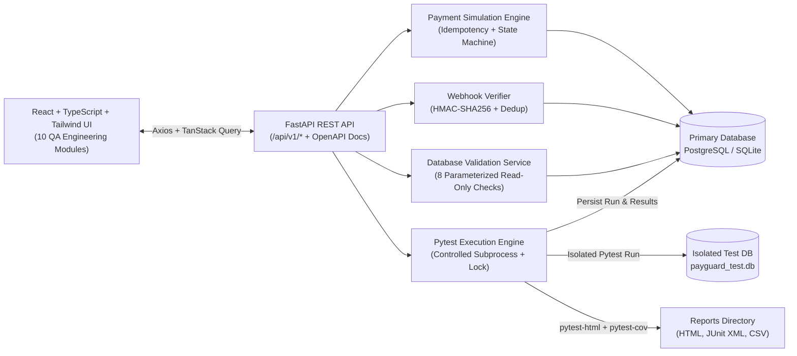

# PayGuard — Payment Gateway Testing & Automation Platform

> **SIMULATED PAYMENT ENVIRONMENT (SANDBOX)**
> PayGuard uses synthetic payment scenarios and never processes real money, connects to live payment gateways, or collects real payment card credentials.

PayGuard is a full-stack, locally runnable **payment reliability engineering and QA automation platform** built to mirror the internal engineering consoles used by fintech quality teams. It combines a real FastAPI + SQLAlchemy backend, database-enforced idempotency and payment state machines, HMAC-SHA256 webhook verification, an executable Pytest automation engine, a read-only database validation console, defect tracking, reporting, and Playwright end-to-end tests.

---

## 1. Project Overview

Modern payment gateways fail in subtle ways: duplicate client retries, concurrent double-clicks, upstream timeouts where settlement status is unknown, out-of-order or duplicated webhooks, tampered webhook payloads, and API-to-database state drift. PayGuard gives developers and QA automation engineers a unified workbench to simulate these failure modes, assert invariants automatically, and inspect persisted evidence across every layer of the stack.

## 2. Problem Statement

Testing payment integrations with static mocks hides the hardest defects in production fintech systems:
- **Duplicate charges** when idempotency keys are not enforced atomically at the database level.
- **False failure reporting** when upstream gateway timeouts are treated as declined payments instead of `PENDING` states requiring reconciliation.
- **Double-processed webhooks** when payment gateways retry webhook delivery after network jitter.
- **Cross-layer inconsistency** where API responses, database rows, and webhook events diverge.
- **Fragmented QA tooling** where API checks, automated regression suites, DB integrity audits, and defect tracking live in disconnected tools.

---

## 3. Architecture Diagram



---

## 4. Technology Stack

| Layer | Technologies |
|---|---|
| **Frontend** | React 18, Vite, TypeScript, Tailwind CSS, React Router, TanStack Query, Recharts, Lucide React, Axios |
| **Backend** | Python 3.12, FastAPI, Pydantic v2, SQLAlchemy 2.0, Alembic, Uvicorn |
| **Database** | PostgreSQL 16 (via Docker Compose) with SQLite WAL + Foreign Keys fallback for zero-friction local dev |
| **Automation & Testing** | Pytest, HTTPX, Requests, Pytest-cov, Pytest-html, Playwright Test |
| **DevOps & Docs** | Docker, Docker Compose, GitHub Actions CI, Swagger / OpenAPI (`/docs`) |

---

## 5. Feature List

1. **Overview Dashboard** — Real database-derived KPIs, date range filters (`24h`, `7d`, `30d`, custom range), transaction volume area chart, status distribution donut, test execution trends, and tabbed recent activity.
2. **Transaction Management** — Searchable, filterable, sortable, paginated transaction ledger with slide-over detail drawer, visual lifecycle timeline, JSON payload inspector, refund (`SUCCESS -> REFUNDED`), and pending reconciliation (`PENDING -> SUCCESS | FAILED`).
3. **Payment Simulator** — 4 simulated methods (`UPI`, `CARD`, `NET_BANKING`, `WALLET`), 10 payment scenarios, SHA-256 payload idempotency enforcement (`200` replay vs `409 Conflict`), concurrent request safety, strict state machine, and live lifecycle progression.
4. **API Testing Console** — Simplified Postman supporting `GET/POST/PUT/PATCH/DELETE`, headers, query params, JSON body, server-side HMAC webhook signing, persistent collections (`PAYMENT APIs`, `AUTHENTICATION`, `NEGATIVE TESTING`, `WEBHOOKS`), and real ASGI/HTTP execution.
5. **Automated Test Suites** — Runs real whitelisted Pytest suites (`all`, `smoke`, `regression`, `edge_cases`, `api_contract`, `database`) in a locked subprocess against an isolated test DB, persists individual test case results, links HTML reports, and offers one-click **Create Bug Report** from failed cases.
6. **Webhook Monitor** — HMAC-SHA256 signature verification, database-level `event_id` deduplication, delivery failure & retry simulation, invalid signature rejection (`401`), and per-event processing logs.
7. **Database Validation Console** — 8 predefined read-only parameterized SQLAlchemy checks plus a cross-layer **Transaction Consistency Checker** (API payload vs DB record vs Webhook event vs Final state).
8. **Bug Tracker** — Full defect lifecycle (`OPEN -> IN_PROGRESS -> FIXED -> VERIFIED -> CLOSED`), severity/priority filtering, transaction & test case linking, and pre-populated bug logging from test failures.
9. **Test Reports & Quality Metrics** — Explicitly separates **Automated Test Pass Rate**, **Code Coverage (`pytest-cov`)**, **Test Case Coverage**, and **Defect Density**, with downloadable CSV transaction & test reports, failure analysis, and HTML report links.
10. **Settings & Demo Reset** — Runtime configuration overview, DB record counts, and **Reset Demo Data** with confirmation dialog restoring the initial seeded baseline (20 success, 5 failed, 3 pending transactions, 5 webhooks, 3 test runs, 3 bugs, 4 API collections).

---

## 6. Installation Instructions

### Prerequisites
- Python 3.11+ (tested on Python 3.12)
- Node.js 20+ (tested on Node 22)
- Optional: Docker & Docker Compose (for PostgreSQL containerized deployment)

### Setup Virtual Environment & Backend Dependencies
```bash
python -m venv .venv
# Windows PowerShell:
.\.venv\Scripts\Activate.ps1
# macOS / Linux:
source .venv/bin/activate

pip install -r backend/requirements.txt
```

### Install Frontend & Playwright Dependencies
```bash
cd frontend
npm install
npx playwright install chromium
cd ..
```

---

## 7. Environment Configuration

Copy `.env.example` to `.env` and customize if needed (never commit `.env` or real secrets):
```bash
cp .env.example .env
```

Key variables:
- `DATABASE_URL` — Defaults to local SQLite (`sqlite:///./payguard.db`); set to `postgresql+psycopg2://...` for PostgreSQL.
- `TEST_DATABASE_URL` — Dedicated isolated test database (`sqlite:///./payguard_test.db`).
- `WEBHOOK_SECRET` — Server-only HMAC-SHA256 signing secret (never exposed to the browser).
- `API_AUTH_TOKEN` — Synthetic sandbox bearer token used by the Authentication API test collection.
- `VITE_API_BASE_URL` — Backend URL consumed by the frontend (`http://127.0.0.1:8000`).

---

## 8. Database Setup & Migrations

Run Alembic migrations to initialize the schema:
```bash
cd backend
../.venv/Scripts/alembic upgrade head
# (On macOS/Linux: ../.venv/bin/alembic upgrade head)
cd ..
```
On first backend startup, PayGuard automatically seeds the initial synthetic demo dataset (flagged with `is_seeded=true`).

---

## 9. Backend Startup

```bash
# From project root (Windows PowerShell):
$env:PYTHONPATH="backend"; .\.venv\Scripts\uvicorn.exe app.main:app --host 127.0.0.1 --port 8000 --reload

# macOS / Linux:
PYTHONPATH=backend .venv/bin/uvicorn app.main:app --host 127.0.0.1 --port 8000 --reload
```
Backend API: `http://127.0.0.1:8000`
Swagger / OpenAPI Docs: `http://127.0.0.1:8000/docs`

---

## 10. Frontend Startup

```bash
cd frontend
npm run dev
```
Frontend Dashboard: `http://127.0.0.1:5173`

### Or Run Everything via Docker Compose (PostgreSQL + Backend + Frontend)
```bash
docker compose up --build
```

---

## 11. Running Automated Backend Tests (Pytest)

```bash
# Run all 66 backend tests with coverage & self-contained HTML report:
.\.venv\Scripts\pytest.exe tests/api tests/payment tests/webhooks tests/database tests/integration \
  --cov=backend/app --cov-report=term-missing \
  --html=reports/pytest-report.html --self-contained-html -v

# Run targeted suites by marker:
.\.venv\Scripts\pytest.exe -m smoke -v
.\.venv\Scripts\pytest.exe -m regression -v
.\.venv\Scripts\pytest.exe -m edge_case -v
.\.venv\Scripts\pytest.exe -m contract -v
.\.venv\Scripts\pytest.exe tests/database -v
```

---

## 12. Running Playwright End-to-End UI Tests

Ensure both backend (`127.0.0.1:8000`) and frontend (`127.0.0.1:5173`) are running, then execute:
```bash
# Windows PowerShell (from project root):
$env:NODE_PATH="$PWD\frontend\node_modules"; npx --prefix frontend playwright test --config playwright.config.ts

# macOS / Linux (from project root):
NODE_PATH=frontend/node_modules npx --prefix frontend playwright test --config playwright.config.ts
```
HTML report is saved to `reports/playwright-report/index.html`.

---

## 13. Generating Test Reports

- **HTML Pytest Reports**: Generated automatically on every UI-triggered suite execution under `reports/<RUN_ID>_<suite>.html` and downloadable via `GET /api/v1/tests/runs/{run_id}/report`.
- **CSV Transaction Report**: `GET /api/v1/reports/transactions.csv` (or click **Transactions CSV** in Test Reports).
- **CSV Test Runs Report**: `GET /api/v1/reports/tests.csv` (or click **Test Runs CSV** in Test Reports).
- **Coverage Report**: `pytest --cov=backend/app --cov-report=html:reports/coverage-html`.

---

## 14. API Documentation

Interactive Swagger UI is served at `http://127.0.0.1:8000/docs` and ReDoc at `http://127.0.0.1:8000/redoc`.

Core Endpoint Groups:
- **Payments**: `POST /api/v1/payments`, `GET /api/v1/payments`, `GET /api/v1/payments/{id}`, `GET /api/v1/payments/{id}/status`, `POST /api/v1/payments/{id}/refund`, `POST /api/v1/payments/{id}/reconcile`
- **Testing**: `POST /api/v1/tests/run`, `GET /api/v1/tests/runs`, `GET /api/v1/tests/runs/{run_id}`, `GET /api/v1/tests/runs/{run_id}/results`, `GET /api/v1/tests/runs/{run_id}/report`
- **Webhooks**: `POST /api/v1/webhooks/payment`, `POST /api/v1/webhooks/simulate`, `GET /api/v1/webhooks/events`, `GET /api/v1/webhooks/events/{event_id}`, `POST /api/v1/webhooks/events/{event_id}/retry`
- **Database Validation**: `GET /api/v1/validation/checks`, `POST /api/v1/validation/run`, `GET /api/v1/validation/results`, `GET /api/v1/validation/consistency/{transaction_id}`
- **Bug Tracker**: `POST /api/v1/bugs`, `GET /api/v1/bugs`, `GET /api/v1/bugs/{bug_id}`, `PATCH /api/v1/bugs/{bug_id}`, `DELETE /api/v1/bugs/{bug_id}`
- **Dashboard & Reports**: `GET /api/v1/dashboard/metrics`, `/transactions`, `/test-activity`, `GET /api/v1/reports/metrics`, `/transactions.csv`, `/tests.csv`
- **API Console & Auth**: `GET/POST /api/v1/collections`, `POST /api/v1/collections/execute`, `GET /api/v1/auth/verify`
- **Health & Settings**: `GET /health`, `GET /api/v1/health`, `GET /api/v1/settings`, `POST /api/v1/settings/reset-demo`

---

## 15. Sample API Requests

### Simulate Payment with Idempotency Key
```bash
curl -X POST http://127.0.0.1:8000/api/v1/payments \
  -H "Content-Type: application/json" \
  -d '{
    "order_id": "ORD-DEMO-9001",
    "amount": "1299.50",
    "currency": "INR",
    "payment_method": "UPI",
    "customer_reference": "cust_qa_01",
    "idempotency_key": "idem-demo-9001",
    "scenario": "successful_payment"
  }'
```

### Trigger Automated Smoke Suite
```bash
curl -X POST http://127.0.0.1:8000/api/v1/tests/run \
  -H "Content-Type: application/json" \
  -d '{"suite_name": "smoke", "with_coverage": true}'
```

### Run All 8 Database Integrity Checks
```bash
curl -X POST http://127.0.0.1:8000/api/v1/validation/run \
  -H "Content-Type: application/json" \
  -d '{}'
```

---

## 16. Test Scenarios

See [`docs/TEST_SCENARIOS.md`](docs/TEST_SCENARIOS.md) for the complete catalog of **66 Pytest backend tests** and **12 Playwright E2E UI tests**.

---

## 17. Database Schema

Normalized SQLAlchemy 2.0 schema managed by Alembic (`backend/alembic/versions/`):
- `transactions`: `id`, `transaction_id` (unique), `order_id`, `amount` (`Numeric(14,2)`), `currency`, `payment_method`, `customer_reference`, `scenario`, `status`, `idempotency_key` (unique), `payload_hash`, `gateway_reference`, `response_code`, `failure_reason`, `processing_duration_ms`, `request_payload` (JSON), `response_payload` (JSON), `timeline` (JSON), `is_seeded`, `created_at`, `updated_at`
- `webhook_events`: `id`, `event_id` (unique), `transaction_id` (FK -> `transactions.transaction_id`), `event_type`, `payload` (JSON), `signature_valid`, `delivery_status`, `attempt_count`, `duplicate_attempts`, `processing_logs` (JSON), `is_seeded`, `created_at`, `delivered_at`
- `test_runs`: `id`, `run_id` (unique), `suite_name`, `total_tests`, `passed`, `failed`, `skipped`, `duration`, `code_coverage`, `execution_status`, `report_path`, `stdout_summary`, `is_seeded`, `started_at`, `completed_at`
- `test_results`: `id`, `run_id` (FK -> `test_runs.run_id`), `test_name`, `node_id`, `test_status`, `failure_message`, `duration`, `created_at`
- `bugs`: `id`, `bug_id` (unique), `title`, `description`, `severity`, `priority`, `status`, `module`, `reproduction_steps`, `expected_result`, `actual_result`, `environment`, `transaction_id` (FK -> `transactions.transaction_id`), `associated_test_case`, `is_seeded`, `created_at`, `updated_at`
- `api_collections`: `id`, `collection_name`, `description`, `configuration` (JSON), `is_seeded`, `created_at`, `updated_at`
- `validation_results`: `id`, `check_key`, `check_name`, `execution_status`, `records_examined`, `issues_detected`, `details` (JSON), `execution_duration_ms`, `executed_at`

---

## 18. CI/CD Architecture

Configured in [`.github/workflows/quality-checks.yml`](.github/workflows/quality-checks.yml):
- Triggers on pushes to `main`, pull requests, and manual `workflow_dispatch`.
- Installs Python 3.12 & Node.js 22 dependencies with caching.
- Applies Alembic migrations (`alembic upgrade head`).
- Executes all Pytest suites with `pytest-cov`, `pytest-html`, and JUnit XML output.
- Builds the React/Vite frontend, launches backend + frontend preview servers, waits for `/health`, and executes the Playwright Chromium E2E test suite.
- Uploads Pytest HTML report, JUnit XML, Coverage HTML, and Playwright HTML report as GitHub Actions artifacts on every run.

---

## 19. Known Limitations

- **Local Database Fallback**: Default local execution uses SQLite (with WAL mode and `PRAGMA foreign_keys=ON`) so the app runs out-of-the-box without installing PostgreSQL locally. For full multi-process PostgreSQL concurrency testing, run via `docker compose up --build`.
- **Single-User Sandbox Auth**: PayGuard models a single-team sandbox QA console without multi-tenant RBAC login; authentication testing is provided via `/api/v1/auth/verify`.
- **Synchronous Test Execution Request**: `POST /api/v1/tests/run` executes Pytest in a locked subprocess and returns full structured results on completion (capped at 180s). For very large enterprise suites, an asynchronous job queue (Celery/RQ + WebSockets) would be preferred.

## 20. Future Improvements

- Real-time Server-Sent Events (SSE) / WebSocket log streaming during long Pytest runs.
- Scheduled automated regression runs with Slack / PagerDuty alert webhooks.
- Chaos engineering fault-injection rules (configurable random latency distributions and error percentages per payment method).
- Multi-user RBAC authentication and audit trails for defect triage.
